Hello, I am Omar! My profile picture, unsurprisingly, features microscopic drawings from Edwin Lankester’s Half-Hours with the Microscope (1860), redrawn in DNA letters. My fascination with these microscopic worlds began while searching for answers about my rare neurological condition, Tachysensia. Through that exploration, I developed a passion for biological research, particularly computational biology. I hope to delve deeper into this field and contribute to innovative approaches for understanding Tachysensia and other rare conditions.

- **Currently:** virtual cell models that predict how human cells respond to genetic perturbations
- **Tools:** Python on Linux, PyTorch, single-cell and sequence models
- **Contact:** [LinkedIn](https://www.linkedin.com/in/omar-sherif-emam) · [omarsherifnaguib@gmail.com](mailto:omarsherifnaguib@gmail.com)

### Publications

**ColiFormer: A Transformer-Based Codon Optimization Model Balancing Multiple Objectives for Enhanced *E. coli* Gene Expression** 
Emam, O., et al. *Bioengineering*, 2026. Co-first author. 
[Paper](https://pmc.ncbi.nlm.nih.gov/articles/PMC12838208/) · [Code](https://github.com/SAKETH11111/ColiFormer)

### Stats

   

---

Open to research internships in computational biology and wet-lab biology.
